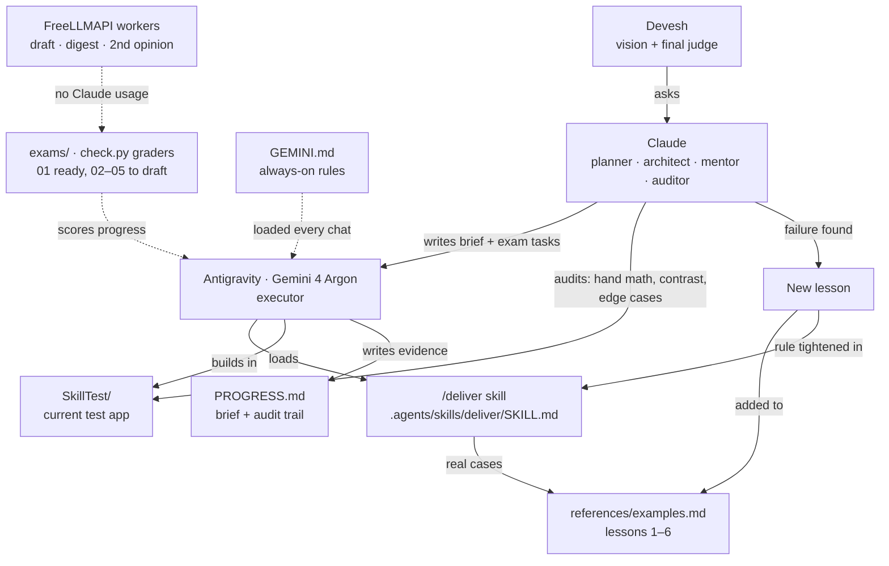

# Antigravity Training Map

The single source of state for the "train Antigravity like a child" project. A new session reads
this file instead of old chats. Update it at the end of every session (scorecard + next steps).

Last updated: 2026-11-24 (session 2)

## Graph

**Loop:** Claude briefs → Argon builds with `/deliver` → Claude audits every step → each failure
becomes a lesson → the lesson tightens the skill → re-test on a *new* task (never the same one,
since its answer is now in the examples).

## Nodes (where things live)

| Node | Path |
|---|---|
| Skill | `~/Documents/Antigravity/.agents/skills/deliver/SKILL.md` (symlinked to `~/.claude/skills/deliver`) |
| Lessons | `.../deliver/references/examples.md` |
| Always-on rules | `~/Documents/Antigravity/GEMINI.md` (repo auto-pushes to GitHub via the Stop hook) |
| Test 1 app (resume matcher) | `~/Documents/Antigravity/SkillTest_run1/` |
| Test 2 app (EXPLAIN analyzer) | `~/Documents/Antigravity/SkillTest/` (runs on :8765 via `run.sh`) |
| Argon transcripts | `~/.gemini/antigravity/brain/<id>/.system_generated/logs/transcript.jsonl` |
| Chat index | `~/.gemini/antigravity/conversation_summaries.db` |

## Why Antigravity failed (from 200+ old chats)

1. No reasoning: 0 thinking tokens; it went straight to writing big files.
2. Scope blow-up: 9 questions in a row, every "Recommended" option the biggest.
3. Faked parts: hardcoded user inputs; keyword if/else posing as AI.
4. Self-certification: "verified" because its own tests passed; invented metrics.
5. Symptom patching after rejection ("You're 100% right" + more branches).
6. Process theatre: 180 sub-agents, visible `<claude_thinking>` rituals.

## Scorecard (audited by Claude, not self-reported)

| Behaviour | Before skill | Test 1 (resume matcher) | Test 2 (EXPLAIN analyzer) |
|---|---|---|---|
| Looks before building | ❌ | ✅ found working Gemini key, real resumes | ✅ |
| Writes brief with expert gaps | ❌ | ✅ | ✅ correct DBA math (loops, 8 KiB blocks) |
| Small build-run loops | ❌ | ❌ 640-line file in one go | ⚠️ appended chunks, but a 74 KB engine |
| Output comes from the input | ❌ | ❌ canned advice; pastry chef scored "89" | ✅ |
| Contrast / bad-input test | ❌ | ❌ | ✅ healthy plan → 0 findings |
| Edge-case math | — | ❌ "8+ years" not parsed | ❌ parallel plans: self time ×3 |
| Honest report | ❌ | ⚠️ | ⚠️ claimed timings "confirmed", parallel untested |
| Scope discipline | ❌ | ❌ | ❌ JSON + practice mode + presets |

## Rule: no Claude models in training

Training uses only FreeLLMAPI workers, Gemini (Antigravity) and deterministic `check.py` graders.
On a worker 429, wait for the reset; never fall back to Claude. See `train-antigravity` skill.

## Open lessons

- Lesson 6 (report only what was tested; v1 = must-haves only) is now in examples.md. Promote it
  into SKILL.md section 7 if exam 01 shows the same overclaim again.

## Next steps

1. **Run exam 01 now:** paste `/deliver ~/Documents/Antigravity/exams/01_parallel_selftime/BRIEF.md`
   into Antigravity (Argon). Baseline on current code (2026-11-24): check.py FAIL (orders 1800
   vs 600 ms, % sum 115), hidden check FAIL (scan 1500 vs 300 ms); non-parallel regression PASS.
2. Grade: `python3 exams/01_parallel_selftime/check.py SkillTest` and
   `python3 ~/.claude/skills/train-antigravity/hidden/01_hidden_check.py SkillTest`, then
   `freellm -m reader` digest of the transcript + `freellm -m auditor` on report honesty.
3. Draft exams 02–05 with `freellm -m tester` / `coder`. **Blocked on 2026-11-24:** all OVH
   models were rate-limited (reset ~24h).
4. Re-run the exam set when new Gemini models ship.
4. Keep `LESSONS.md` short: promote proven lessons into the skill, delete unused ones.

## Free-model runner KB (added 2026-11-25)
SOP + known issues + student record for the free-model browser runner: `~/Documents/Anthropic/runner/SOP_KB.md`. Worker pass/fail log: `~/.claude/skills/freellm-workers/LOG.md`. New models read SOP_KB first.
